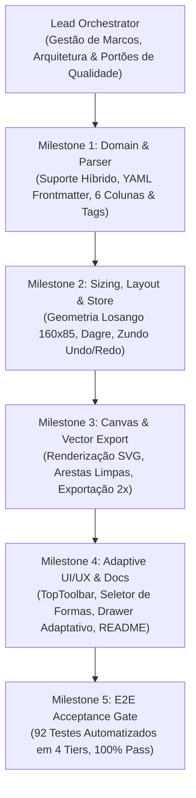

# Gerador e Editor Interativo de Diagramas: Mapas Conceituais & Fluxogramas


%20%7C%20Fluxograma%20(ISO%2FANSI)-blue)
-8B5CF6)

Aplicação web local interativa de arquitetura híbrida para **criação manual**, **geração automática a partir de tabelas Markdown** (como [`exemplo.md`](exemplo.md) e [`exemplo-fluxograma.md`](exemplo-fluxograma.md)) e **edição gráfica de alta precisão** de **Mapas Conceituais de Joseph Novak** e **Fluxogramas de Processos (ISO/ANSI 5807)**, com motores de auto-layout em múltiplas camadas, 6 formas geométricas autênticas, histórico temporal de Undo/Redo e exportação em `.cmap.json`, `.md`, `.svg` vetorial puro e `.png` em alta resolução (`2x DPI`).

---

## Sumário

1. [Principais Funcionalidades (Features Híbridas)](#1-principais-funcionalidades-features-híbridas)
2. [Requisitos e Execução Local](#2-requisitos-e-execução-local)
3. [Especificação de Entrada Markdown & Diretivas de Modo](#3-especificação-de-entrada-markdown--diretivas-de-modo)
   - 3.1. [Diretivas YAML Frontmatter e Modo do Diagrama](#31-diretivas-yaml-frontmatter-e-modo-do-diagrama)
   - 3.2. [Catálogo Canônico das 6 Formas Geométricas de Fluxograma](#32-catálogo-canônico-das-6-formas-geométricas-de-fluxograma)
   - 3.3. [Sintaxe de Formas Declaradas Inline nos Nós](#33-sintaxe-de-formas-declaradas-inline-nos-nós)
   - 3.4. [Transições de Fluxo, Rótulos Opcionais e Condições Rápidas](#34-transições-de-fluxo-rótulos-opcionais-e-condições-rápidas)
   - 3.5. [Mapas Conceituais Clássicos (Novak) e Retrocompatibilidade](#35-mapas-conceituais-clássicos-novak-e-retrocompatibilidade)
4. [Guia de Criação Manual e Edição Gráfica](#4-guia-de-criação-manual-e-edição-gráfica)
   - 4.1. [Barra Superior Adaptativa (TopToolbar) e Alternador de Modo](#41-barra-superior-adaptativa-toptoolbar-e-alternador-de-modo)
   - 4.2. [Inspetor de Propriedades Lateral (PropertyInspector)](#42-inspetor-de-propriedades-lateral-propertyinspector)
   - 4.3. [Modal e Gaveta Tabular (PropositionsDrawer)](#43-modal-e-gaveta-tabular-propositionsdrawer)
   - 4.4. [Atalhos de Mouse e Teclado](#44-atalhos-de-mouse-e-teclado)
5. [Motores de Layout Automático](#5-motores-de-layout-automático)
6. [Persistência e Formatos de Exportação](#6-persistência-e-formatos-de-exportação)
7. [Arquitetura e Contratos de Tipos](#7-arquitetura-e-contratos-de-tipos)
8. [Desenvolvimento com Múltiplos Agentes de IA](#8-desenvolvimento-com-múltiplos-agentes-de-ia)
9. [Tags do Projeto](#9-tags-do-projeto)
10. [AI Disclaimer (Declaração de Uso de IA)](#10-ai-disclaimer-declaração-de-uso-de-ia)

---

## 1. Principais Funcionalidades (Features Híbridas)

- **Plataforma Híbrida 2-em-1 (Mapas Conceituais & Fluxogramas):** Alterne instantaneamente entre os modos **`Mapa Conceitual` (Novak)** e **`Fluxograma` (ISO/ANSI)** através do controle deslizante da barra superior. A UI inteira (botões de criação, inspetor lateral, tabelas e algoritmos recomendados) se adapta dinamicamente ao domínio selecionado.
- **Catálogo de 6 Formas Geométricas Autênticas + Nós de Conceito:**
  - **Terminal (Início / Fim):** Estádio/pílula arredondada com realce esmeralda no início e ardósia/rosa no encerramento.
  - **Processo (Etapa / Ação):** Retângulo clássico para instruções e tarefas operacionais.
  - **Decisão (Losango / Diamante):** Geometria com 4 portas ortogonais nos vértices e dimensionamento garantido ($\ge 160 \times 85\,\text{px}$) para inscrição precisa de texto.
  - **Entrada / Saída (Dados I/O):** Paralelogramo inclinado a $-14^\circ$.
  - **Sub-rotina (Subprocesso):** Retângulo com barras verticais duplas internas.
  - **Documento:** Retângulo com base sinusoidal ondulada para arquivos e relatórios.
- **Ramificação Condicional Rápida (1-Clique):** Ao selecionar um nó de decisão, acione o botão `+ Sim/Não` para criar simultaneamente os ramos positivo e negativo com rótulos e desvios pré-configurados.
- **Transições Diretas sem Rótulo:** Em fluxogramas, setas sequenciais entre etapas não exigem rótulos forçados, renderizando uma linha ortogonal contínua limpa. Rótulos condicionais (`Sim` e `Não`) recebem destaque em verde e vermelho/âmbar.
- **Menu `Novo ▾` Expandido com Starters Prontos:** Inicie um **Novo Mapa Conceitual**, um **Novo Fluxograma**, carregue os exemplos do disco ([`exemplo.md`](exemplo.md) ou [`exemplo-fluxograma.md`](exemplo-fluxograma.md)) ou use o **Canvas em Branco** com 1 clique sem diálogos bloqueantes.
- **5 Motores de Auto-Layout Adaptativos:**
  - **Dagre Compacto:** Recomendado para fluxogramas sequenciais e desvios lógicos.
  - **Hierárquico Novak (Backbone 2-Fases):** Recomendado para mapas conceituais clássicos com diferenciação progressiva e reconciliação integrativa.
  - **ELK Layered Unificado**, **Orgânico (D3-Force)** e **Radial / Centralidade**.
- **Fixação Automática de Posição (`📌 Pinning`):** Movimentações manuais são memorizadas e preservadas nas execuções de auto-layout.
- **Edição Tabular e Lista Centralizada de Blocos:** Edite conexões e formas geométricas diretamente pela tabela interativa ou pela nova aba **Lista de Blocos**.
- **Histórico Temporal Completo (`Undo / Redo`):** 60 níveis de desfazer/refazer (`Ctrl+Z` / `Ctrl+Y`) abrangendo todas as mutações visuais e semânticas.
- **Exportação Multiformato:** `.cmap.json` (projeto completo), `.md` (tabela Markdown com frontmatter), `.svg` (vetor autônomo com geometria SVG precisa) e `.png` (2x DPI).

---

## 2. Requisitos e Execução Local

### Pré-requisitos
- **Node.js** `>= 18` (validado em Linux com Node.js `v24.19.0`)
- **NPM** `>= 9`

### Instalação e Inicialização
No diretório raiz do projeto:

```bash
# 1. Instalar as dependências do projeto
npm install

# 2. Iniciar o servidor local de desenvolvimento (Vite)
npm run dev
```

Abra **`http://localhost:5173`** no navegador.

### Scripts de Verificação e Qualidade
```bash
# Verificar tipagem estática rigorosa do TypeScript (0 erros)
npm run typecheck

# Executar suíte completa de testes unitários e de integração (Vitest)
npm test

# Executar a suíte completa de testes E2E (92 testes em 4 tiers)
./tests/e2e/run-e2e.sh

# Gerar build otimizado de produção na pasta dist/
npm run build

# Servir localmente o build de produção compilado
npm run preview
```

---

## 3. Especificação de Entrada Markdown & Diretivas de Modo

### 3.1. Diretivas YAML Frontmatter e Modo do Diagrama

A aplicação suporta blocos YAML frontmatter no topo dos arquivos `.md` para declarar explicitamente o modo do diagrama, título e orientações:

```markdown
---
type: flowchart
title: Processo de Atendimento ao Cliente
direction: TB
---
```

Diretivas alternativas também são reconhecidas de forma transparente:
- Comentário HTML: `<!-- type: flowchart -->` ou `<!-- diagram: fluxograma -->`
- Metadados inline: `@type: flowchart` ou `Tipo de Diagrama: Fluxograma`
- Detecção heurística automática: tabelas com cabeçalhos `Origem | Destino` ou nós marcados com tags de fluxo são reconhecidas como fluxogramas; tabelas com `Conceito A | Frase de ligação | Conceito B` são classificadas como mapas conceituais.

### 3.2. Catálogo Canônico das 6 Formas Geométricas de Fluxograma

| Forma (`nodeShape`) | Nome Semântico (ISO/ANSI 5807) | Geometria no Canvas e SVG | Tags Inline Suportadas |
| :--- | :--- | :--- | :--- |
| **`terminal`** | Ponto de Início ou Fim | Pílula/Estádio (`rx="9999"`); esmeralda para Início, ardósia para Fim | `[Início]`, `[Fim]`, `[Terminador]`, `(Início)`, `(Fim)` |
| **`process`** | Etapa, Operação ou Ação | Retângulo clássico com bordas arredondadas suaves | `[Processo]`, `[Ação]`, `[Etapa]`, `[ ]` |
| **`decision`** | Decisão Lógica / Desvio | Losango (diamante) com 4 portas nos vértices ($\ge 160 \times 85\,\text{px}$) | `[Decisão]`, `[Condição]`, `<Decisão>`, `{Pergunta?}` |
| **`io`** | Entrada / Saída de Dados | Paralelogramo inclinado (`skewX(-14deg)`) | `[Entrada/Saída]`, `[E/S]`, `[I/O]`, `[/Dados/]` |
| **`subroutine`** | Subprocesso / Procedimento | Retângulo com barras verticais duplas internas | `[Subprocesso]`, `[Sub-rotina]`, `[[Rotina]]` |
| **`document`** | Documento / Relatório | Retângulo com base inferior sinusoidal ondulada | `[Documento]`, `[Relatório]`, `~Relatório~` |
| **`concept`** | Conceito Padrão (Novak) | Retângulo arredondado padrão com borda neutra azul/ardósia | `[Conceito]`, ou texto sem tag |

### 3.3. Sintaxe de Formas Declaradas Inline nos Nós

O parser interpreta automaticamente marcadores geométricos inseridos antes ou ao redor dos nomes dos blocos:

```markdown
---
type: flowchart
title: Exemplo de Pipeline
---

| # | Origem | Condição / Transição | Destino | Tipo / Forma |
|---|---|---|---|---|
| 1 | [Início] Iniciar Pedido | | [/Entrada/Saída/] Ler Dados | início -> entrada/saída |
| 2 | [/Entrada/Saída/] Ler Dados | | [Processo] Calcular Total | entrada/saída -> processo |
| 3 | [Processo] Calcular Total | | <Decisão> Pagamento Aprovado? | processo -> decisão |
| 4 | <Decisão> Pagamento Aprovado? | Sim | [[Subprocesso]] Emitir Nota Fiscal | condicional |
| 5 | <Decisão> Pagamento Aprovado? | Não | ~Documento~ Notificar Erro | condicional |
| 6 | ~Documento~ Notificar Erro | Corrigir | [/Entrada/Saída/] Ler Dados | retorno |
| 7 | [[Subprocesso]] Emitir Nota Fiscal | | (Fim) Entrega Realizada | fim |
```

### 3.4. Transições de Fluxo, Rótulos Opcionais e Condições Rápidas

A coluna de transição / condição aceita:
- **Células Vazias (`| |`):** Representam fluxo sequencial direto padrão (`flowKind: 'sequence'`). No canvas e no SVG, a seta é desenhada continuamente sem pílulas vazias desnecessárias.
- **Rótulos Condicionais (`Sim`, `Não`, `Aprovado`):** Classificados como `flowKind: 'conditional'`. O sistema aplica realces coloridos contextuais nos rótulos.
- **Retornos de Fluxo (`Retornar`, `Loop`):** Classificados como `flowKind: 'loop-back'`, orientando o roteador de curvas a utilizar desvios limpos.

### 3.5. Mapas Conceituais Clássicos (Novak) e Retrocompatibilidade

A plataforma preserva **100% de retrocompatibilidade** com o arquivo [`exemplo.md`](exemplo.md). Em modo Mapa Conceitual:
- As colunas canônicas são: `| # | Conceito A | Frase de ligação | Conceito B | Tipo |`.
- Frases de ligação utilizam proposições verbais expressas (`propõe`, `abriga`, `afetam`).
- A coluna `Tipo` distingue relações `hierárquica` (linha sólida contínua) e `ligação cruzada` (linha tracejada âmbar).

---

## 4. Guia de Criação Manual e Edição Gráfica

### 4.1. Barra Superior Adaptativa (TopToolbar) e Alternador de Modo

- **Badge Dinâmico:** Exibe `CM` (azul) para Mapa Conceitual ou `FC` (índigo) para Fluxograma (`data-testid="toolbar-mode-badge"`).
- **Segmented Control Switcher:** Alternador de 1 clique com `data-testid="mode-switcher-concept-map"` e `data-testid="mode-switcher-flowchart"`.
- **Menu `Novo ▾` (`data-testid="toolbar-new-menu-btn"`):**
  - `Novo Mapa Conceitual` (`data-testid="menu-new-concept-map"`)
  - `Novo Fluxograma` (`data-testid="menu-new-flowchart"`)
  - `Carregar exemplo.md` (`data-testid="menu-load-concept-map-example"`)
  - `Carregar exemplo-fluxograma.md` (`data-testid="menu-load-flowchart-example"`)
  - `Canvas em Branco (Livre)` (`data-testid="menu-new-blank-canvas"`)
- **Botões Centrais Contextuais:**
  - Em modo fluxograma: renderiza `+ Etapa` (`data-testid="toolbar-add-process-btn"`) e `+ Decisão` (`data-testid="toolbar-add-decision-btn"`).
  - Em modo mapa conceitual: renderiza `+ Conceito` (`data-testid="toolbar-add-concept-btn"`).
- **Popover `+ Transição` / `+ Ligação`:** Adapta os campos para aceitar rótulos opcionais em fluxogramas e tipos de transição (`Sequencial`, `Condicional`, `Retorno`).
- **Botão Recarregar Exemplo (`data-testid="toolbar-reload-example-btn"`):** Recarrega o exemplo correspondente ao modo ativo diretamente do disco.

### 4.2. Inspetor de Propriedades Lateral (PropertyInspector)

- **Seletor Visual de Forma Geométrica (Feature 43):** Miniaturas SVG das 7 formas com rótulo em português. Ao clicar, atualiza o modelo e redimensiona os limites de forma automática via `updateNodeShape`.
- **Inspetor de Transição (Feature 44):**
  - Permite condições vazias sem emitir avisos ou forçar texto padrão.
  - Botões de atalho rápido de 1 clique: `Sim`, `Não` e `Limpar`.
  - Seletor de tipo de transição com 3 estados (`Sequência`, `Condicional`, `Retorno`).
  - Roteamento ortogonal padrão (`smoothstep`) com botão de restauração.

### 4.3. Modal e Gaveta Tabular (PropositionsDrawer)

- **Cabeçalhos Adaptativos (Feature 45):**
  - Fluxograma: `| # | Origem | Condição / Transição | Destino | Forma | Ações |`
  - Mapa Conceitual: `| # | Conceito A | Frase de ligação | Conceito B | Tipo | Ações |`
- **Exibição Limpa de Condições Vazias:** Exibe placeholder discreto `—`.
- **Edição Inline de Formas (Feature 46):** Dropdowns para alterar formas tanto no bloco de origem quanto no de destino.
- **Aba Lista de Blocos:** Visão unificada de todos os nós com seletor de forma geométrica, contagem de entradas/saídas e botão de foco no canvas.
- **Aba Markdown Sincronizada:** Exibe o frontmatter YAML correspondente e aplica edições manuais diretamente ao grafo.

### 4.4. Atalhos de Mouse e Teclado

| Interação / Atalho | Ação Executada |
| :--- | :--- |
| **`Duplo Clique` no fundo do canvas** | Cria um novo bloco na posição clicada |
| **`Clique` em um bloco → `+ Ramificar`** | Cria um novo bloco filho conectado ao selecionado |
| **`Clique` em um nó de decisão → `+ Sim/Não`** | Gera automaticamente ramificações condicionalmente rotuladas |
| **`Arrastar` de um handle para o vazio** | Cria um novo bloco conectado onde o mouse for solto |
| **`Arrastar` de um handle para outro nó** | Conecta dois blocos existentes |
| **`Duplo Clique` em bloco ou rótulo** | Edição de texto inline (`Enter` confirma, `Esc` cancela) |
| **`Ctrl + Z`** | Desfazer última alteração (Undo) |
| **`Ctrl + Y` ou `Ctrl + Shift + Z`** | Refazer alteração (Redo) |
| **`Ctrl + K` ou `Ctrl + F`** | Focar no campo de busca rápida |
| **`Delete` ou `Backspace`** | Excluir nós e conexões selecionados |
| **`P`** | Fixar / Desafixar (`📌 Pin`) a posição do(s) nó(s) |
| **`T`** | Alternar tipo da conexão selecionada |
| **`R`** | Inverter direção da transição (`Origem ↔ Destino`) |

---

## 5. Motores de Layout Automático

O sistema integra 5 motores de layout com suporte a orientação Vertical (`⬇ TB`) e Horizontal (`➡ LR`):

1. **Dagre Compacto (Recomendado para Fluxogramas):** Layout topológico otimizado com roteamento ortogonal de transições e minimização de cruzamentos.
2. **Hierárquico Novak (Recomendado para Mapas Conceituais):** Algoritmo de 2 fases que estabelece a hierarquia estrita pelos ramos estruturais e acomoda ligações cruzadas lateralmente sem deformar a profundidade.
3. **ELK Layered Unificado:** Algoritmo Sugiyama completo de alto desempenho via biblioteca Web Worker.
4. **Orgânico (D3-Force):** Simulação física com forças de repulsão de corpos e atração elástica de arestas.
5. **Radial / Centralidade:** Distribuição concêntrica a partir de um conceito raiz.

---

## 6. Persistência e Formatos de Exportação

No menu **`Exportar ▾`**:
- **Salvar Projeto (`.cmap.json`):** Salva o modelo semântico estendido (modos, formas dos nós, tipos de transição) e o modelo visual (posições, dimensões, estilos).
- **Exportar Markdown (`.md`):** Exporta tabela Markdown com cabeçalho YAML frontmatter (`type: flowchart` ou `type: concept-map`).
- **Exportar Imagem Vetorial (`.svg`):** Gera SVG autônomo e puro, renderizando elementos geométricos dedicados (`<polygon>` para losangos e paralelogramos, `<rect rx="..." ry="...">` para terminais, `<path>` para documentos e linhas verticais para subprocessos) e omitindo pílulas em transições vazias.
- **Exportar PNG Alta Resolução (`2x`):** Renderiza o diagrama completo em canvas HTML5 a 2x DPI para publicação em apresentações e artigos acadêmicos.

---

## 7. Arquitetura e Contratos de Tipos

```
src/
├── domain/            # Tipos de domínio canônicos (DiagramMode, FlowchartNodeShape, RelationType)
├── store/             # Store reativa Zustand com extensão Zundo para Undo/Redo temporal
├── services/
│   ├── parser/        # Parsers tolerantes a falhas e serializadores Markdown com YAML
│   ├── layout/        # Motores de auto-layout (Dagre, ELK, D3-Force, Novak) e sizing
│   ├── export/        # Exportadores vetoriais SVG puros e rasterizadores PNG
│   └── workspaceBridge.ts # Carregamento de arquivos do workspace local
├── components/
│   ├── toolbar/       # TopToolbar adaptativa com alternador de modo e menu Novo
│   ├── inspector/     # PropertyInspector com seletor visual de formas e atalhos Sim/Não
│   ├── modals/        # PropositionsDrawer com tabela adaptativa, abas de blocos e markdown
│   └── canvas/        # Canvas React Flow, nós geométricos customizados e arestas ortogonais
```

### Contratos de Tipos Centrais (`src/domain/types.ts`)
```ts
export type DiagramMode = 'concept-map' | 'flowchart';

export type FlowchartNodeShape =
  | 'concept'
  | 'terminal'
  | 'process'
  | 'decision'
  | 'io'
  | 'subroutine'
  | 'document';

export type FlowTransitionKind = 'sequence' | 'conditional' | 'loop-back';
```

---

## 8. Desenvolvimento com Múltiplos Agentes de IA

Este projeto foi projetado e implementado através de uma arquitetura colaborativa de **Múltiplos Agentes de IA (Multi-Agent System)**, na qual um Coordenador Principal orquestrou subagentes especializados ao longo dos marcos de evolução:



---

## 9. Tags do Projeto

`#concept-map` `#flowchart` `#fluxograma` `#novak-concept-map` `#mapa-conceitual` `#react-flow` `#elkjs` `#dagre` `#d3-force` `#markdown-to-graph` `#typescript` `#react` `#zustand` `#multi-agent-ai` `#gemini-argon` `#knowledge-visualization` `#interactive-diagram-editor`

---

## 10. AI Disclaimer (Declaração de Uso de IA)

> [!NOTE]
> **Declaração de Transparência sobre Uso de Inteligência Artificial**
>
> Este software, sua arquitetura modular, motores de layout, suíte de testes automatizados e documentação técnica foram desenvolvidos com o auxílio de **Múltiplos Agentes de Inteligência Artificial** operados pelo modelo **Gemini Argon** configurado no **nível de raciocínio médio (*Medium Reasoning Level*)**.
>
> - **Modelo Principal e Subagentes:** **Gemini Argon** (*Reasoning Effort / Thinking Level: Medium*).
> - **Metodologia:** Orquestração multiagente em marcos sequenciais (M1: Domínio & Parser; M2: Geometria, Layout & Store; M3: Canvas & SVG Export; M4: UI/UX Adaptativa & Documentação; M5: Aceite E2E Rígido), seguida de validação determinística local via compilador TypeScript (`tsc --noEmit`), suíte de testes automatizados Vitest (`npm test`), bateria E2E de 92 testes (`./tests/e2e/run-e2e.sh`) e build de produção (`vite build`).
> - **Supervisão Humana:** Todas as decisões arquiteturais, especificações de requisitos e validações funcionais foram revisadas e validadas rigorosamente.
