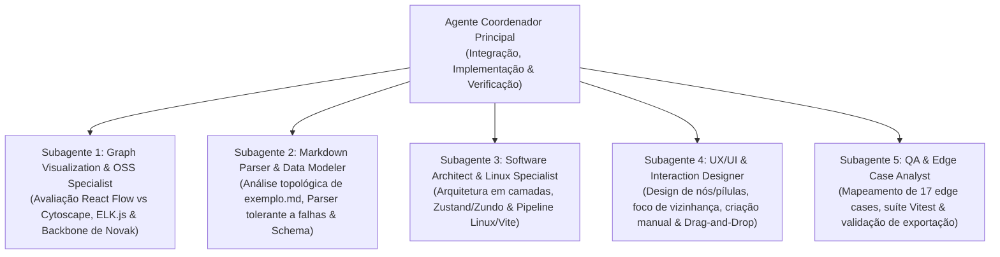

# Gerador e Editor Interativo de Mapas Conceituais


-8B5CF6)

Aplicação web local interativa para **criação manual**, **geração automática a partir de tabelas Markdown** (como [`exemplo.md`](exemplo.md)) e **edição gráfica completa** de **Mapas Conceituais de Novak**, com motores de layout em múltiplas camadas, histórico temporal de Undo/Redo e exportação em `.cmap.json`, `.md`, `.svg` vetorial e `.png` de alta resolução (`2x DPI`).

---

## Sumário

1. [Principais Funcionalidades (Features)](#1-principais-funcionalidades-features)
2. [Requisitos e Execução Local](#2-requisitos-e-execução-local)
3. [Modelo de Entrada e Tags de Relação (`exemplo.md`)](#3-modelo-de-entrada-e-tags-de-relação-exemplomd)
4. [Guia de Criação Manual e Edição Gráfica](#4-guia-de-criação-manual-e-edição-gráfica)
5. [Motores de Layout Automático](#5-motores-de-layout-automático)
6. [Persistência e Formatos de Exportação](#6-persistência-e-formatos-de-exportação)
7. [Arquitetura e Tecnologias Utilizadas](#7-arquitetura-e-tecnologias-utilizadas)
8. [Desenvolvimento com Múltiplos Agentes de IA](#8-desenvolvimento-com-múltiplos-agentes-de-ia)
9. [Tags do Projeto](#9-tags-do-projeto)
10. [AI Disclaimer (Declaração de Uso de IA)](#10-ai-disclaimer-declaração-de-uso-de-ia)

---

## 1. Principais Funcionalidades (Features)

- **Abertura em Mapa em Branco Pronta para Criação:** A aplicação inicia diretamente em um **canvas totalmente em branco** com um painel de boas-vindas interativo, permitindo começar um mapa conceitual do zero, carregar o arquivo [`exemplo.md`](exemplo.md) com 1 clique ou arrastar qualquer arquivo `.md` para a tela.
- **Criação Manual Ágil de Blocos e Ligações:**
  - **Botão `+ Ramificar` no bloco selecionado:** Cria imediatamente um novo conceito filho já conectado ao bloco atual.
  - **Arrastar da borda para o vazio:** Puxe uma seta de qualquer uma das 4 portas de um bloco e solte em uma área vazia do canvas para criar um novo bloco conectado naquela posição.
  - **Criador rápido de proposições (`+ Ligação`):** Adicione proposições completas (`Bloco A -> Frase de Ligação -> Bloco B`) com autocompletar; se os blocos ainda não existirem no mapa, eles são criados e conectados automaticamente.
  - **Duplo clique no fundo ou botão `+ Bloco`:** Cria blocos avulsos em qualquer coordenada do canvas.
- **Drag-and-Drop de Arquivos `.md` direto na Tela do Navegador:** Arraste qualquer arquivo `.md` (ou projeto `.cmap.json`) do gerenciador de arquivos do sistema operacional para qualquer ponto da janela do navegador para gerar um novo mapa conceitual instantaneamente.
- **5 Motores de Layout Automático (com Backbone Hierárquico de Novak):** Inclui o algoritmo **Hierárquico Novak (Backbone de 2 Fases)**, que utiliza exclusivamente as relações `hierárquica` para construir as camadas verticais/horizontais e roteia as relações `ligação cruzada` sem deformar a hierarquia, além de **ELK Layered**, **Dagre Compacto**, **Orgânico (D3-Force)** e **Radial / Centralidade**.
- **Fixação Automática de Posição (`📌 Pinning`):** Qualquer bloco movido manualmente com o mouse é automaticamente marcado como fixado (`pinned: true`), garantindo que sua posição escolhida seja respeitada ao acionar o botão **Organizar**.
- **Edição Gráfica Completa com Mouse e Teclado:**
  - Edição de texto inline com duplo clique tanto nos blocos de conceitos quanto nas pílulas de frases de ligação.
  - Redimensionamento livre de blocos com alças visuais (`<NodeResizer>`).
  - Reconexão de extremidades de setas (origem/destino), inversão de direção (`A ↔ B`) e alternância entre `hierárquica` (linha sólida) e `ligação cruzada` (linha tracejada âmbar).
  - Personalização de cores de fundo, borda, texto, tipo de curva (`SmoothStep`, `Bezier`, `Reta`) e notas de rodapé no **Inspetor Lateral de Propriedades**.
- **Foco Inteligente de Vizinhança (Hover) e Filtros de Ligações Cruzadas:** Passar o cursor sobre um conceito destaca sua vizinhança de 1º grau (conceitos e frases diretamente conectadas) e atenua o restante do grafo. A legenda inferior permite mostrar todas, atenuar, destacar ou ocultar ligações cruzadas.
- **Editor Tabular e Código Markdown Sincronizado (`Tabela`):** Visualize, adicione, edite ou exclua proposições em uma tabela interativa ou edite diretamente o código Markdown de 5 colunas em tempo real.
- **Histórico Temporal Completo (`Undo / Redo`):** Suporte a até 60 níveis de desfazer/refazer (`Ctrl+Z` / `Ctrl+Y`) cobrindo movimentações, criações, edições e exclusões em cascata.
- **Exportação Profissional em 4 Formatos:** `.cmap.json` (projeto completo com posições e estilos), `.md` (tabela Markdown de 5 colunas), `.svg` (vetor escalável autônomo) e `.png` (imagem rasterizada em alta resolução `2x DPI`).

---

## 2. Requisitos e Execução Local

### Pré-requisitos
- **Node.js** `>= 18` (validado em Linux com Node.js `v24.19.0`)
- **NPM** `>= 9`

### Instalação e Inicialização
No diretório raiz do projeto, execute:

```bash
# 1. Instalar as dependências do projeto
npm install

# 2. Iniciar o servidor local de desenvolvimento (Vite)
npm run dev
```

Abra **`http://localhost:5173`** no navegador. A aplicação abrirá em um **mapa em branco**, pronta para você criar seu mapa ou carregar o [`exemplo.md`](exemplo.md).

### Scripts Disponíveis
```bash
# Executar todos os testes unitários e de integração (Vitest)
npm test

# Verificar tipagem estática do TypeScript
npm run typecheck

# Gerar build otimizado de produção na pasta dist/
npm run build

# Servir localmente o build de produção
npm run preview
```

---

## 3. Modelo de Entrada e Tags de Relação (`exemplo.md`)

A aplicação interpreta tabelas Markdown que descrevem proposições no modelo teórico de **Joseph Novak**:

$$\text{Conceito A (Origem)} \xrightarrow{\text{Frase de ligação (Verbo)}} \text{Conceito B (Destino)}$$

### 3.1. Formatos de Tabela Aceitos
O parser ([`markdownParser.ts`](src/services/parser/markdownParser.ts)) detecta automaticamente tabelas com **5 colunas** (incluindo índice `#`, como em [`exemplo.md`](exemplo.md)) ou **4 colunas** (sem coluna `#`):

**Formato de 5 colunas (padrão de [`exemplo.md`](exemplo.md) e da exportação `.md`):**
```markdown
| # | Conceito A | Frase de ligação | Conceito B | Tipo |
|---|---|---|---|---|
| 1 | Projeto POP | propõe | Cinturão de proteção | hierárquica |
| 2 | Cinturão de proteção | ao redor da | Reserva Ducke | hierárquica |
| 3 | Reserva Ducke | abriga | Recursos hídricos | hierárquica |
| 4 | Impactos ambientais | afetam | Recursos hídricos | ligação cruzada |
```

**Formato de 4 colunas:**
```markdown
| Conceito A | Frase de ligação | Conceito B | Tipo |
|---|---|---|---|
| Projeto POP | propõe | Cinturão de proteção | hierárquica |
| Impactos ambientais | afetam | Recursos hídricos | ligação cruzada |
```

### 3.2. Tags de Classificação de Relações (Coluna `Tipo`)
A coluna **`Tipo`** define o papel estrutural e visual de cada proposição no Mapa Conceitual. O parser normaliza acentuação e caixa (maiúsculas/minúsculas) e reconhece as seguintes tags:

| Categoria Semântica | Tags Aceitas na Coluna `Tipo` | Representação Visual no Mapa | Papel no Motor de Layout |
| :--- | :--- | :--- | :--- |
| **Relação Hierárquica** *(Subordinação / Diferenciação Progressiva)* | `hierárquica`, `hierarquica`, `hierarchical`, `subordinação`, `subordinacao`, `estrutural` *(ou vazio)* | **Linha sólida contínua** (`#475569`), curva ortogonal suave (`smoothstep`), pílula de texto com borda neutra | Define a **espinha dorsal (backbone)** e a profundidade de camadas verticais/horizontais do mapa |
| **Ligação Cruzada** *(Reconciliação Integrativa entre ramos)* | `ligação cruzada`, `ligacao cruzada`, `cruzada`, `cross-link`, `crosslink`, `cross`, `transversal`, `associativa` | **Linha tracejada âmbar** (`#d97706`, `stroke-dasharray`), curva Bézier contínua, pílula âmbar em itálico | Conecta conceitos de ramos distintos **sem puxar nós superiores para camadas inferiores** |

### 3.3. Regras de Normalização e Tolerância a Falhas
- **Deduplicação canônica de conceitos:** Conceitos com grafias equivalentes (diferenças de maiúsculas/minúsculas ou múltiplos espaços internos) são fundidos em um único nó, preservando o rótulo da primeira aparição e emitindo um aviso não-bloqueante.
- **Deduplicação de proposições idênticas:** Linhas repetidas com o mesmo `(Conceito A, Frase de ligação, Conceito B, Tipo)` são ignoradas automaticamente; múltiplas relações entre o mesmo par de conceitos com frases de ligação distintas são preservadas e renderizadas com deslocamento paralelo automático.
- **Tolerância a erros:** Textos fora da tabela são ignorados e linhas malformadas geram diagnósticos consultáveis no modal **Tabela**, sem interromper o carregamento.

---

## 4. Guia de Criação Manual e Edição Gráfica

### 4.1. Formas de Iniciar ou Carregar um Mapa
1. **Começar do Zero (Padrão ao abrir):** Ao abrir a aplicação, use os botões centrais para criar o primeiro bloco, criar uma proposição inicial ou dê **duplo clique** em qualquer lugar do fundo.
2. **Menu `Novo Mapa ▾` (Barra Superior):** Permite limpar a tela a qualquer momento, escolhendo entre *Novo Mapa (com Bloco Inicial)* ou *Canvas Totalmente em Branco*.
3. **Arrastar `.md` para o Navegador (Drag-and-Drop):** Arraste o arquivo [`exemplo.md`](exemplo.md) (ou qualquer outro `.md` / `.cmap.json`) e solte sobre a janela do navegador.
4. **Botão `↻` ou `Importar`:** O botão `↻` na barra superior carrega imediatamente o arquivo [`exemplo.md`](exemplo.md) do workspace local; o botão `Importar` abre o seletor de arquivos do sistema.

### 4.2. Atalhos de Mouse e Teclado

| Interação / Atalho | Ação Executada |
| :--- | :--- |
| **`Duplo Clique` no fundo do canvas** | Cria um novo bloco de conceito na posição clicada |
| **`Clique` em um bloco → `+ Ramificar`** | Cria um novo bloco filho já conectado ao bloco selecionado |
| **`Arrastar` da bolinha azul para o vazio** | Cria um novo bloco conectado exatamente onde você soltar o mouse |
| **`Arrastar` da bolinha azul até outro bloco** | Cria uma nova proposição conectando os dois blocos existentes |
| **`Duplo Clique` em um bloco ou frase** | Abre edição de texto inline (`Enter` confirma, `Esc` cancela) |
| **`Arrastar` ponta da seta selecionada** | Reconecta a origem ou o destino da proposição para outro bloco |
| **`Ctrl + Z`** | Desfazer última ação (Undo) |
| **`Ctrl + Y` ou `Ctrl + Shift + Z`** | Refazer ação (Redo) |
| **`Ctrl + K` ou `Ctrl + F`** | Focar campo de busca rápida e destaque de conceitos/frases |
| **`Delete` ou `Backspace`** | Excluir blocos e conexões selecionados (com remoção em cascata de arestas órfãs) |
| **`P`** | Fixar / Desafixar (`📌 Pin`) a posição do(s) bloco(s) selecionado(s) |
| **`T`** | Alternar tipo da conexão selecionada (`hierárquica` ↔ `ligação cruzada`) |
| **`R`** | Inverter direção da seta selecionada (`Conceito A ↔ Conceito B`) |

---

## 5. Motores de Layout Automático

O seletor na barra superior oferece **5 algoritmos de layout** (nas orientações **Vertical `⬇ TB`** e **Horizontal `➡ LR`**):

1. **Hierárquico Novak (Backbone 2-Fases — Recomendado):**
   - *Fase 1:* Constrói um subgrafo apenas com as proposições `hierárquica`, posicionando a raiz no topo e distribuindo os conceitos em níveis hierárquicos claros via ELK Layered (`NETWORK_SIMPLEX`).
   - *Fase 2:* Insere as proposições `ligação cruzada` escolhendo portas laterais (`left`/`right`) inteligentes e distribuindo o parâmetro $t \in [0.28, 0.72]$ das caixas de texto ao longo da curva para evitar colisões.
2. **ELK Layered Unificado:** Executa o algoritmo de Sugiyama sobre todas as arestas simultaneamente, atribuindo peso direcional `10x` maior para relações hierárquicas.
3. **Dagre Compacto:** Árvore hierárquica enxuta e rápida via `@dagrejs/dagre`.
4. **Orgânico (D3-Force):** Simulação física de forças (`forceManyBody`, `forceLink`, `forceCollide` retangular) para visualização de clusters e hubs.
5. **Radial / Centralidade:** Posiciona o conceito raiz no centro e distribui os demais níveis em órbitas concêntricas.

---

## 6. Persistência e Formatos de Exportação

No menu **`Exportar ▾`** da barra superior:
- **Salvar Projeto (`.cmap.json`):** Salva o documento completo contendo tanto o `SemanticModel` (conceitos, proposições, tipos, notas) quanto o `VisualModel` (coordenadas `x/y`, dimensões customizadas, estado `pinned`, cores e estilo das curvas).
- **Exportar Markdown (`.md`):** Serializa todas as proposições atuais do mapa em uma tabela Markdown padronizada de 5 colunas (`| # | Conceito A | Frase de ligação | Conceito B | Tipo |`).
- **Exportar Imagem Vetorial (`.svg`):** Gera um arquivo SVG 100% autônomo e escalável calculando o *bounding box* completo do mapa.
- **Exportar PNG Alta Resolução (`2x`):** Renderiza o mapa completo em um canvas HTML5 com `devicePixelRatio = 2` para máxima nitidez textual em relatórios e slides.

---

## 7. Arquitetura e Tecnologias Utilizadas

| Camada | Tecnologia | Descrição |
| :--- | :--- | :--- |
| **Linguagem & Bundler** | **TypeScript 5.7** + **Vite 6** | Tipagem estrita, HMR instantâneo e middleware local para leitura de `exemplo.md`. |
| **UI & Componentes** | **React 18** + **Tailwind CSS 3** + **Lucide React** | Interface responsiva, barra superior, modal tabular e inspetor contextual. |
| **Motor Gráfico de Grafo** | **`@xyflow/react` (React Flow v12)** | Canvas interativo DOM/SVG, handles em 4 direções, minimapa, zoom/pan e reconexão de arestas. |
| **Algoritmos de Layout** | **`elkjs`** + **`@dagrejs/dagre`** + **`d3-force`** | Motores matemáticos de posicionamento hierárquico, físico e radial com resolução de colisão AABB. |
| **Gerenciamento de Estado** | **`zustand`** + **`zundo`** | Store reativa desacoplando `SemanticModel` e `VisualModel` com máquina do tempo de Undo/Redo. |
| **Qualidade & Testes** | **Vitest** | 23 testes automatizados cobrindo parser, serializador round-trip, 5 layouts, store, Undo/Redo e exportadores. |

---

## 8. Desenvolvimento com Múltiplos Agentes de IA

Este projeto foi concebido, planejado e engenheirado utilizando uma **arquitetura colaborativa de Múltiplos Agentes de IA (Multi-Agent System)**, na qual um Agente Coordenador Principal orquestrou **5 subagentes especialistas** em paralelo durante a fase de pesquisa, arquitetura e especificação técnica:



1. **Graph Visualization & OSS Specialist:** Avaliou bibliotecas open-source de grafos e projetou o algoritmo híbrido de duas fases (Backbone Hierárquico de Novak + roteamento não-estrutural de ligações cruzadas).
2. **Markdown Parser & Data Modeler:** Realizou a análise matemática e estrutural do grafo de [`exemplo.md`](exemplo.md) (32 conceitos, 46 proposições, 6 níveis de profundidade sem ciclos) e especificou a separação estrita entre `SemanticModel` e `VisualModel`.
3. **Software Architect & Linux Specialist:** Definiu a stack Web Local em Linux (`Vite + React + TypeScript`), o gerenciamento de estado com `zustand` + `zundo` e a divisão modular do código.
4. **UX/UI & Interaction Designer:** Projetou as interações visuais de manipulação direta (criação rápida com `+ Ramificar`, arraste para o vazio, diferenciação visual entre relações hierárquicas e cruzadas, e Drag-and-Drop de arquivos `.md`).
5. **QA & Edge Case Analyst:** Mapeou os 17 cenários críticos e casos extremos (multigrafos, ciclos, rótulos longos, caracteres XML especiais em SVG, preservação de nós fixados) e estruturou a suíte de testes automatizados.

---

## 9. Tags do Projeto

`#concept-map` `#novak-concept-map` `#mapa-conceitual` `#react-flow` `#elkjs` `#dagre` `#d3-force` `#markdown-to-graph` `#typescript` `#react` `#zustand` `#multi-agent-ai` `#gemini-argon` `#knowledge-visualization` `#interactive-graph-editor`

---

## 10. AI Disclaimer (Declaração de Uso de IA)

> [!NOTE]
> **Declaração de Transparência sobre Uso de Inteligência Artificial**
>
> Este software, sua arquitetura modular, motores de layout, suíte de testes automatizados e documentação técnica foram desenvolvidos com o auxílio de **Múltiplos Agentes de Inteligência Artificial** operados pelo modelo **Gemini Argon** configurado no **nível de raciocínio médio (*Medium Reasoning Level*)**.
>
> - **Modelo Principal e Subagentes:** **Gemini Argon** (*Reasoning Effort / Thinking Level: Medium*).
> - **Metodologia:** Orquestração multiagente (1 agente coordenador + 5 subagentes especialistas em visualização de grafos, modelagem de dados/parsing, arquitetura Linux, UX/UI e engenharia de qualidade), seguida de validação determinística local via compilador TypeScript (`tsc --noEmit`), suíte de testes automatizados (`vitest`) e build de produção (`vite build`).
> - **Supervisão Humana:** Todas as decisões arquiteturais, escolhas de experiência de usuário (QoL) e validações funcionais foram revisadas e aprovadas pelo desenvolvedor responsável.
