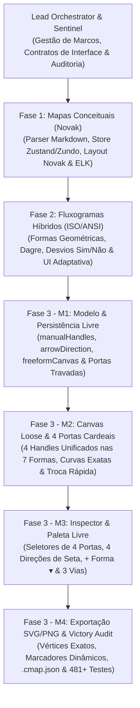

# Gerador e Editor Interativo de Diagramas: Mapas Conceituais, Fluxogramas & Canvas Livre


-22C55E)


Aplicação web local interativa para **criação manual**, **geração automática a partir de tabelas Markdown** e **edição gráfica livre de alta precisão** em **3 modalidades operacionais**:
1. **Mapas Conceituais (Joseph Novak)** — [`exemplo.md`](exemplo.md)
2. **Fluxogramas de Processos (ISO/ANSI 5807)** — [`exemplo-fluxograma.md`](exemplo-fluxograma.md)
3. **Canvas Livre (Freeform Ponto a Ponto)** — [`exemplo-canvas-livre.cmap.json`](exemplo-canvas-livre.cmap.json) e [`exemplo-canvas-livre.md`](exemplo-canvas-livre.md)

Conta com **7 formas geométricas combináveis**, conexões irrestritas ponto a ponto entre quaisquer **4 portas cardeais** (`top`, `right`, `bottom`, `left`), **4 direções de seta** (`→`, `←`, `↔`, `—`), **5 motores de auto-layout**, histórico temporal de **Undo/Redo** (60 níveis) e exportação fiel em `.cmap.json`, `.md`, `.svg` vetorial puro e `.png` em alta resolução (`2x DPI`).

---

## Sumário

1. [Principais Funcionalidades e as 3 Modalidades](#1-principais-funcionalidades-e-as-3-modalidades)
2. [Arquivos de Exemplo das 3 Modalidades](#2-arquivos-de-exemplo-das-3-modalidades)
3. [Requisitos e Execução Local](#3-requisitos-e-execução-local)
4. [Especificação de Entrada Markdown & Diretivas de Modo](#4-especificação-de-entrada-markdown--diretivas-de-modo)
   - 4.1. [Diretivas YAML Frontmatter e Modo do Diagrama](#41-diretivas-yaml-frontmatter-e-modo-do-diagrama)
   - 4.2. [Catálogo Canônico das 7 Formas Geométricas](#42-catálogo-canônico-das-7-formas-geométricas)
   - 4.3. [Sintaxe de Formas Declaradas Inline nos Nós](#43-sintaxe-de-formas-declaradas-inline-nos-nós)
   - 4.4. [Transições de Fluxo, Rótulos Opcionais e Condições Rápidas](#44-transições-de-fluxo-rótulos-opcionais-e-condições-rápidas)
   - 4.5. [Mapas Conceituais Clássicos (Novak) e Retrocompatibilidade](#45-mapas-conceituais-clássicos-novak-e-retrocompatibilidade)
5. [Guia de Criação Manual, Canvas Livre e Edição Gráfica](#5-guia-de-criação-manual-canvas-livre-e-edição-gráfica)
   - 5.1. [Painel Inicial de Boas-vindas (Triple Pathways)](#51-painel-inicial-de-boas-vindas-triple-pathways)
   - 5.2. [Barra Superior Adaptativa (TopToolbar) e Paleta Rápida de Formas](#52-barra-superior-adaptativa-toptoolbar-e-paleta-rápida-de-formas)
   - 5.3. [Inspetor de Propriedades Lateral (Portas Cardeais, Direção de Seta e Formas)](#53-inspetor-de-propriedades-lateral-portas-cardeais-direção-de-seta-e-formas)
   - 5.4. [Modal e Gaveta Tabular (PropositionsDrawer)](#54-modal-e-gaveta-tabular-propositionsdrawer)
   - 5.5. [Atalhos de Mouse e Teclado](#55-atalhos-de-mouse-e-teclado)
6. [Motores de Layout Automático](#6-motores-de-layout-automático)
7. [Persistência e Formatos de Exportação](#7-persistência-e-formatos-de-exportação)
8. [Arquitetura e Contratos de Tipos](#8-arquitetura-e-contratos-de-tipos)
9. [Desenvolvimento com Múltiplos Agentes de IA](#9-desenvolvimento-com-múltiplos-agentes-de-ia)
10. [Tags do Projeto](#10-tags-do-projeto)
11. [AI Disclaimer (Declaração de Uso de IA)](#11-ai-disclaimer-declaração-de-uso-de-ia)

---

## 1. Principais Funcionalidades e as 3 Modalidades

- **Plataforma 3-em-1 (Mapa Conceitual, Fluxograma e Canvas Livre):**
  - **Mapa Conceitual (Novak):** Estruturação hierárquica baseada em proposições explícitas (`Conceito A → Frase de Ligação → Conceito B`), diferenciação progressiva e ligações cruzadas.
  - **Fluxograma de Processos (ISO/ANSI 5807):** Fluxos sequenciais, desvios condicionais (`Sim` / `Não`), retornos de loop, entradas/saídas, subprocessos e documentos.
  - **Canvas Livre (Freeform):** Modo de diagramação irrestrita (`freeformCanvas: true`) onde nenhuma heurística automática sobrescreve portas, formas ou posições escolhidas pelo usuário.
- **Conexões Ponto a Ponto Irrestritas ($4 \times 4 = 16$ Combinações de Portas):**
  - Cada um dos **7 formatos geométricos** possui **4 portas cardeais unificadas** (`top`, `right`, `bottom`, `left`) operando em `ConnectionMode.Loose` sem colisão de DOM, com área de toque expandida (`28px`) e destaque luminoso ao aproximar o cursor.
  - Qualquer porta de origem pode ser conectada a qualquer porta de destino, inclusive criando **múltiplas conexões paralelas independentes** entre o mesmo par de blocos em portas distintas.
  - Portas escolhidas manualmente (por arraste no canvas, reconexão de extremidade ou seleção no Inspector) recebem travamento permanente (`manualHandles: true`), preservando a escolha mesmo ao mover blocos (`moveNodes`), editar textos (`updateRelation`), alterar formatos (`updateNodeShape`) ou trocar o modo do diagrama.
- **Controle Total de Direção de Seta (`arrowDirection`):**
  - Escolha livremente o sentido visual das setas em qualquer conexão:
    - **Direta (`forward`):** `Origem → Destino`
    - **Invertida (`reverse`):** `Origem ← Destino`
    - **Bidirecional (`both`):** `Origem ↔ Destino`
    - **Sem Seta / Linha Livre (`none`):** `Origem — Destino`
  - Além do botão de inversão semântica `Origem ↔ Destino` (`reverseRelationDirection`), que também inverte simetricamente `sourceHandle ↔ targetHandle` quando manuais.
- **Catálogo de 7 Formas Geométricas Combináveis:**
  - **Conceito (`concept`):** Retângulo arredondado clássico para conceitos e entidades.
  - **Terminal (`terminal`):** Pílula/estádio arredondado para pontos de Início/Fim ou interfaces externas.
  - **Processo (`process`):** Retângulo operacional para etapas, serviços e ações.
  - **Decisão (`decision`):** Losango (diamante) com ancoragem matemática exata nos 4 vértices cardeais ($\ge 160 \times 85\,\text{px}$).
  - **Entrada / Saída (`io`):** Paralelogramo inclinado (`skewX(-14deg)`) para fluxos de dados e mensageria.
  - **Sub-rotina (`subroutine`):** Retângulo com barras verticais duplas internas para módulos e pipelines.
  - **Documento (`document`):** Retângulo com base sinusoidal ondulada para relatórios, logs e artefatos.
- **Paleta Rápida `+ Forma ▾` e Seletor Flutuante no Bloco:** Insira qualquer uma das 7 formas com 1 clique pela barra superior ou altere instantaneamente o formato de qualquer bloco selecionado através do menu flutuante no próprio canvas.
- **5 Motores de Auto-Layout + Fixação Automática (`📌 Pinning`):** Dagre Compacto, Hierárquico Novak (2-Fases), ELK Layered, Orgânico (D3-Force) e Radial/Centralidade.
- **Exportação Multiformato de Alta Fidelidade:** `.cmap.json` (preservação round-trip completa de portas, direções e modo livre), `.md` (tabela Markdown com frontmatter YAML), `.svg` (vetor autônomo com coordenadas exatas nos 4 pontos cardeais e `<marker>` dinâmicos) e `.png` (`2x DPI`).

---

## 2. Arquivos de Exemplo das 3 Modalidades

O repositório inclui arquivos de exemplo prontos na raiz para testar imediatamente cada uma das 3 modalidades (acessíveis tanto pelos botões do painel inicial e menu `Novo ▾` quanto por *drag-and-drop* na janela):

| Modalidade | Arquivo(s) na Raiz | Descrição do Exemplo | Como Carregar na UI |
| :--- | :--- | :--- | :--- |
| **1. Mapa Conceitual (Novak)** | [`exemplo.md`](exemplo.md) | Mapa conceitual com 32 conceitos e 46 proposições (31 hierárquicas e 15 ligações cruzadas) sobre governança ambiental, Reserva Ducke e atuação parlamentar. | Card **Mapa Conceitual** → `Carregar exemplo.md` ou Menu `Novo ▾` → `Carregar exemplo.md` |
| **2. Fluxograma (ISO/ANSI)** | [`exemplo-fluxograma.md`](exemplo-fluxograma.md) | Pipeline completo de CI/CD, Code Review, SAST, Homologação Canário e Rollback utilizando formas geométricas de fluxograma e desvios `Sim`/`Não`. | Card **Fluxograma** → `Carregar exemplo-fluxograma.md` ou Menu `Novo ▾` → `Carregar exemplo-fluxograma.md` |
| **3. Canvas Livre (Freeform)** | [`exemplo-canvas-livre.cmap.json`](exemplo-canvas-livre.cmap.json)<br>[`exemplo-canvas-livre.md`](exemplo-canvas-livre.md) | Arquitetura Distribuída de IA e Observabilidade combinando **todas as 7 formas geométricas**, conexões manuais nas **4 portas cardeais** (`top`, `right`, `bottom`, `left`), **conexões paralelas** e as **4 direções de seta** (`forward`, `reverse`, `both`, `none`). | Card **Canvas Livre** → `Carregar exemplo-canvas-livre` ou Menu `Novo ▾` → `Carregar exemplo-canvas-livre` |

---

## 3. Requisitos e Execução Local

### Pré-requisitos
- **Node.js** `>= 18` (validado em Linux com Node.js `v24.19.0`)
- **NPM** `>= 9`

### Instalação e Inicialização
No diretório raiz do projeto:

```bash
# 1. Instalar as dependências do projeto
npm install

# 2. Iniciar o servidor local de desenvolvimento (Vite)
npm run dev
```

Abra **`http://localhost:5173`** no navegador.

### Scripts de Verificação e Qualidade
```bash
# Verificar tipagem estática rigorosa do TypeScript (0 erros)
npm run typecheck

# Executar suíte completa de testes unitários, integração e desafios empíricos (23 suítes, 481+ testes)
npm test

# Executar a suíte dedicada de testes E2E (4 tiers)
./tests/e2e/run-e2e.sh

# Gerar build otimizado de produção na pasta dist/
npm run build

# Servir localmente o build de produção compilado
npm run preview
```

---

## 4. Especificação de Entrada Markdown & Diretivas de Modo

### 4.1. Diretivas YAML Frontmatter e Modo do Diagrama

A aplicação suporta blocos YAML frontmatter no topo dos arquivos `.md` para declarar explicitamente o modo do diagrama (`concept-map` ou `flowchart`), o modo Canvas Livre (`freeform: true`), título e orientação:

```markdown
---
type: concept-map
freeform: true
title: Arquitetura Distribuída de IA e Observabilidade (Canvas Livre)
---
```

Ou para um fluxograma estruturado:

```markdown
---
type: flowchart
title: Pipeline de CI/CD, Code Review e Deploy em Produção
direction: TB
---
```

Diretivas alternativas também são reconhecidas de forma transparente:
- Comentário HTML: `<!-- type: flowchart -->` ou `<!-- diagram: fluxograma -->`
- Metadados inline: `@type: flowchart` ou `Tipo de Diagrama: Fluxograma`
- Detecção heurística automática: tabelas com cabeçalhos `Origem | Destino` são reconhecidas como fluxogramas; tabelas com `Conceito A | Frase de ligação | Conceito B` são classificadas como mapas conceituais.

### 4.2. Catálogo Canônico das 7 Formas Geométricas

| Forma (`nodeShape`) | Nome Semântico | Geometria no Canvas e SVG | Tags Inline Suportadas |
| :--- | :--- | :--- | :--- |
| **`concept`** | Conceito Padrão (Novak) | Retângulo arredondado padrão com borda azul/ardósia | `[Conceito]`, ou texto sem tag em Mapa Conceitual |
| **`terminal`** | Ponto de Início ou Fim | Pílula/Estádio (`rx="9999"`); esmeralda ou ardósia | `[Início]`, `[Fim]`, `[Terminador]`, `(Início)`, `(Fim)` |
| **`process`** | Etapa, Operação ou Ação | Retângulo clássico com bordas arredondadas suaves | `[Processo]`, `[Ação]`, `[Etapa]`, `[ ]` |
| **`decision`** | Decisão Lógica / Desvio | Losango (diamante) com 4 portas nos vértices ($\ge 160 \times 85\,\text{px}$) | `[Decisão]`, `[Condição]`, `<Decisão>`, `{Pergunta?}` |
| **`io`** | Entrada / Saída de Dados | Paralelogramo inclinado (`skewX(-14deg)`) | `[Entrada/Saída]`, `[E/S]`, `[I/O]`, `[/Dados/]` |
| **`subroutine`** | Subprocesso / Sub-rotina | Retângulo com barras verticais duplas internas | `[Subprocesso]`, `[Sub-rotina]`, `[[Rotina]]` |
| **`document`** | Documento / Relatório | Retângulo com base inferior sinusoidal ondulada | `[Documento]`, `[Relatório]`, `~Relatório~` |

### 4.3. Sintaxe de Formas Declaradas Inline nos Nós

O parser interpreta automaticamente marcadores geométricos inseridos antes ou ao redor dos nomes dos blocos tanto em Fluxogramas quanto em Mapas Conceituais / Canvas Livre:

```markdown
| # | Origem | Condição / Transição | Destino | Tipo / Forma |
|---|---|---|---|---|
| 1 | [Início] Iniciar Pedido | | [/Entrada/Saída/] Ler Dados | início -> entrada/saída |
| 2 | [/Entrada/Saída/] Ler Dados | | [Processo] Calcular Total | entrada/saída -> processo |
| 3 | [Processo] Calcular Total | | <Decisão> Pagamento Aprovado? | processo -> decisão |
| 4 | <Decisão> Pagamento Aprovado? | Sim | [[Subprocesso]] Emitir Nota Fiscal | condicional |
| 5 | <Decisão> Pagamento Aprovado? | Não | ~Documento~ Notificar Erro | condicional |
```

### 4.4. Transições de Fluxo, Rótulos Opcionais e Condições Rápidas

- **Células Vazias (`| |`):** Representam fluxo sequencial direto (`flowKind: 'sequence'`), renderizando uma linha contínua sem pílula vazia.
- **Rótulos Condicionais (`Sim`, `Não`):** Classificados como `flowKind: 'conditional'` com realces semânticos em esmeralda e rosa/âmbar.
- **Retornos de Fluxo (`Retornar`, `Loop`):** Classificados como `flowKind: 'loop-back'`.

### 4.5. Mapas Conceituais Clássicos (Novak) e Retrocompatibilidade

A plataforma preserva **100% de retrocompatibilidade** com [`exemplo.md`](exemplo.md):
- Colunas canônicas: `| # | Conceito A | Frase de ligação | Conceito B | Tipo |`.
- A coluna `Tipo` distingue relações `hierárquica` (linha sólida contínua) e `ligação cruzada` (linha tracejada âmbar).

---

## 5. Guia de Criação Manual, Canvas Livre e Edição Gráfica

### 5.1. Painel Inicial de Boas-vindas (Triple Pathways)

Ao iniciar a aplicação ou escolher `Tela Inicial (Boas-vindas)`, o painel apresenta as **3 modalidades** lado a lado:
1. **Mapa Conceitual (Novak):** Iniciar com conceito raiz (`create-concept-map-btn`) ou carregar [`exemplo.md`](exemplo.md) (`load-concept-map-example-btn`).
2. **Fluxograma (Processos):** Iniciar template estruturado (`create-flowchart-btn`) ou carregar [`exemplo-fluxograma.md`](exemplo-fluxograma.md) (`load-flowchart-example-btn`).
3. **Canvas Livre (Freeform):** Iniciar Canvas Livre (`create-freeform-btn`), carregar [`exemplo-canvas-livre.cmap.json`](exemplo-canvas-livre.cmap.json) (`load-freeform-example-btn`) ou abrir o Canvas Livre em Branco (`load-freeform-blank-btn`).

### 5.2. Barra Superior Adaptativa (TopToolbar) e Paleta Rápida de Formas

- **Alternador de Modo (`Mapa Conceitual` | `Fluxograma`):** Alterna instantaneamente o modo semântico preservando portas manuais (`manualHandles`) e o estado do Canvas Livre.
- **Menu `Novo ▾` (`data-testid="toolbar-new-menu-btn"`):**
  - `Novo Mapa Conceitual` (`menu-new-concept-map`)
  - `Novo Fluxograma` (`menu-new-flowchart`)
  - `Novo Canvas Livre (Freeform)` (`menu-new-freeform`)
  - `Carregar exemplo.md` (`menu-load-concept-map-example`)
  - `Carregar exemplo-fluxograma.md` (`menu-load-flowchart-example`)
  - `Carregar exemplo-canvas-livre` (`menu-load-freeform-example`)
  - `Tela Inicial (Boas-vindas)` (`menu-new-blank-canvas`)
- **Paleta Rápida `+ Forma ▾` (`data-testid="toolbar-shape-palette-btn"`):** Permite inserir imediatamente no canvas qualquer uma das **7 formas geométricas** (`Conceito`, `Início / Fim`, `Processo`, `Decisão`, `Entrada / Saída`, `Sub-rotina`, `Documento`) independentemente do modo ativo.
- **Troca Rápida de Forma no Bloco Selecionado:** Ao clicar em qualquer bloco no canvas, a barra de ações flutuante exibe o botão `Forma ▾` (`node-action-shape-trigger`) para alternar seu formato geométrico com 1 clique.

### 5.3. Inspetor de Propriedades Lateral (Portas Cardeais, Direção de Seta e Formas)

- **Ao selecionar um Bloco (Nó):**
  - **Seletor Visual das 7 Formas Geométricas:** Disponível em todas as modalidades para misturar formatos livremente.
  - **Formulário `"Nova Conexão a partir deste Bloco"`:** Permite criar conexões escolhendo o bloco de destino, o texto/condição, o **Ponto de Saída (`sourceHandle`)** (`auto`, `top`, `right`, `bottom`, `left`) e o **Ponto de Chegada (`targetHandle`)** (`auto`, `top`, `right`, `bottom`, `left`).
- **Ao selecionar uma Conexão (Aresta):**
  - **Ponto de Saída na Origem (`sourceHandle`) e Ponto de Chegada no Destino (`targetHandle`):** Seletores visuais para fixar manualmente qualquer um dos 4 pontos cardeais (`Topo ↑`, `Direita →`, `Base ↓`, `Esquerda ←`) ou retornar ao modo `Automático`.
  - **Direção da Conexão (`arrowDirection`):** Seletor de 4 estados:
    - `Origem → Destino` (`forward`)
    - `Origem ← Destino` (`reverse`)
    - `Bidirecional (↔)` (`both`)
    - `Sem Seta (—)` (`none`)
  - **Inverter `Origem ↔ Destino`:** Inverte os nós de origem e destino e troca automaticamente `sourceHandle ↔ targetHandle` quando as portas são manuais.
  - **Estilo da Curva:** `Ortogonal (SmoothStep)`, `Curva Suave (Bezier)` ou `Linha Reta (Straight)`, calculando o vetor exato de entrada/saída conforme a porta cardeal selecionada.

### 5.4. Modal e Gaveta Tabular (PropositionsDrawer)

- **Cabeçalhos Adaptativos:** Alterna entre a visão proposicional de Mapas Conceituais e a visão de Transições de Fluxograma.
- **Aba Lista de Blocos:** Visão centralizada de todos os nós com seletor inline das 7 formas geométricas, contagem de conexões e foco rápido no canvas.
- **Aba Markdown Sincronizada:** Edição bidirecional da tabela Markdown e diretivas YAML frontmatter.

### 5.5. Atalhos de Mouse e Teclado

| Interação / Atalho | Ação Executada |
| :--- | :--- |
| **`Duplo Clique` no fundo do canvas** | Cria um novo bloco na posição clicada |
| **`Arrastar` de qualquer uma das 4 portas (`top`, `right`, `bottom`, `left`) para outra porta** | Cria conexão ponto a ponto fixada nas portas escolhidas (`manualHandles: true`) |
| **`Arrastar` a ponta de uma aresta existente para outra porta** | Reconecta a extremidade da aresta e trava a nova porta escolhida |
| **`Arrastar` de uma porta para o vazio** | Cria um novo bloco já conectado onde o mouse for solto |
| **`Clique` em um bloco → `Forma ▾`** | Troca instantaneamente o formato geométrico do bloco entre as 7 opções |
| **`Clique` em um nó de decisão → `+ Sim/Não`** | Gera automaticamente ramificações condicionais rotuladas |
| **`Duplo Clique` em bloco ou rótulo** | Edição de texto inline (`Enter` confirma, `Esc` cancela) |
| **`Ctrl + Z` / `Ctrl + Y`** | Desfazer (Undo) / Refazer (Redo) até 60 estados |
| **`Ctrl + K` ou `Ctrl + F`** | Focar no campo de busca rápida |
| **`Delete` ou `Backspace`** | Excluir nós e conexões selecionados |
| **`P`** | Fixar / Desafixar (`📌 Pin`) a posição do(s) nó(s) |
| **`T`** | Alternar tipo da conexão selecionada |
| **`R`** | Inverter direção da conexão (`Origem ↔ Destino` e portas manuais) |

---

## 6. Motores de Layout Automático

O sistema integra **5 motores de layout** com suporte a orientação Vertical (`⬇ TB`) e Horizontal (`➡ LR`), preservando sempre as portas manuais (`manualHandles: true`) e o modo Canvas Livre (`freeformCanvas: true`):

1. **Dagre Compacto:** Layout topológico otimizado para fluxogramas sequenciais e desvios condicionais.
2. **Hierárquico Novak (Backbone 2-Fases):** Algoritmo clássico de 2 fases que estabelece a hierarquia estrita pelos ramos estruturais e acomoda ligações cruzadas sem distorcer as camadas.
3. **ELK Layered Unificado:** Algoritmo Sugiyama completo via `elkjs`.
4. **Orgânico (D3-Force):** Simulação física com forças de repulsão de corpos e atração elástica.
5. **Radial / Centralidade:** Distribuição concêntrica a partir do conceito raiz.

---

## 7. Persistência e Formatos de Exportação

No menu **`Exportar ▾`**:
- **Salvar Projeto (`.cmap.json`):** Salva e restaura com 100% de fidelidade os modelos semântico e visual, incluindo as 7 formas (`nodeShape`), portas manuais (`sourceHandle`, `targetHandle`, `manualHandles`), direção das setas (`arrowDirection`) e configuração `freeformCanvas`.
- **Exportar Markdown (`.md`):** Exporta tabela Markdown com cabeçalho YAML frontmatter e tags de formas geométricas.
- **Exportar Imagem Vetorial (`.svg`):** Gera SVG autônomo puro com cálculo exato das 4 portas cardeais para cada uma das 7 formas (incluindo os 4 vértices exatos do losango `decision`) e marcadores `<marker>` (`marker-start` e `marker-end`) correspondentes a `arrowDirection` (`forward`, `reverse`, `both`, `none`).
- **Exportar PNG Alta Resolução (`2x`):** Renderiza o SVG vetorial em canvas HTML5 a `2x DPI` preservando todas as portas e direções de seta.

---

## 8. Arquitetura e Contratos de Tipos

```
src/
├── domain/
│   └── types.ts                    # Contratos de domínio (DiagramMode, FlowchartNodeShape, HandlePosition, ArrowDirection)
├── store/
│   ├── useConceptMapStore.ts       # Store Zustand + Zundo com proteção de manualHandles e freeformCanvas
│   └── __tests__/                  # Testes unitários da store
├── services/
│   ├── parser/                     # Parser e serializador Markdown tolerante a falhas com YAML frontmatter
│   ├── layout/                     # Motores de layout (Dagre, ELK, D3-Force, Novak) e cálculo dimensional
│   ├── export/                     # Exportador vetorial SVG puro, PNG 2x e validação JSON .cmap.json
│   └── workspaceBridge.ts          # Ponte para carregamento dos exemplos das 3 modalidades
├── components/
│   ├── canvas/
│   │   ├── ConceptMapCanvas.tsx    # Canvas React Flow (ConnectionMode.Loose), 3 vias iniciais e marcadores
│   │   ├── ConceptNode.tsx         # 7 formas geométricas, 4 portas cardeais unificadas e seletor flutuante
│   │   ├── PropositionEdge.tsx     # Geometria de curvas por porta cardeal e renderização de setas
│   │   └── shapeDefinitions.tsx    # Catálogo visual e ícones das 7 formas geométricas
│   ├── inspector/
│   │   └── PropertyInspector.tsx   # Seletores de portas (4 pontos), direção de seta (4 modos) e formas
│   ├── toolbar/
│   │   └── TopToolbar.tsx          # Barra superior adaptativa, menu Novo com 3 modalidades e paleta + Forma ▾
│   └── modals/
│       └── PropositionsDrawer.tsx  # Gaveta tabular interativa, Lista de Blocos e editor Markdown
└── tests/                          # Suítes E2E e testes de desafio empírico (M1–M4 e Tiers 1–5)
```

### Contratos de Tipos Centrais (`src/domain/types.ts`)
```ts
export type DiagramMode = 'concept-map' | 'flowchart';

export type FlowchartNodeShape =
  | 'concept'
  | 'terminal'
  | 'process'
  | 'decision'
  | 'io'
  | 'subroutine'
  | 'document';

export type HandlePosition = 'top' | 'bottom' | 'left' | 'right' | 'auto';

export type ArrowDirection = 'forward' | 'reverse' | 'both' | 'none';
```

---

## 9. Desenvolvimento com Múltiplos Agentes de IA

Este projeto foi desenvolvido e auditado através de uma arquitetura colaborativa de **Múltiplos Agentes de IA (Multi-Agent System)** em fases evolutivas com portões formais de verificação (Explorers, Workers, Reviewers, Challengers e Forensic/Victory Auditors):



---

## 10. Tags do Projeto

`#concept-map` `#flowchart` `#freeform-canvas` `#canvas-livre` `#fluxograma` `#novak-concept-map` `#mapa-conceitual` `#react-flow` `#elkjs` `#dagre` `#d3-force` `#markdown-to-graph` `#typescript` `#react` `#zustand` `#multi-agent-ai` `#knowledge-visualization` `#interactive-diagram-editor`

---

## 11. AI Disclaimer (Declaração de Uso de IA)

> [!NOTE]
> **Declaração de Transparência sobre Uso de Inteligência Artificial**
>
> Este software, sua arquitetura modular para as 3 modalidades (Mapa Conceitual, Fluxograma e Canvas Livre), motores de layout, exportador vetorial SVG/PNG, suíte de testes automatizados e documentação técnica foram desenvolvidos com o auxílio de **Múltiplos Agentes de Inteligência Artificial**.
>
> - **Metodologia Multiagente:** Orquestração estruturada em marcos com investigação preliminar (*Explorers*), implementação isolada (*Workers*), revisão de código (*Reviewers*), testes adversariais empíricos (*Challengers*) e auditoria forense independente (*Victory Auditor*).
> - **Verificação Determinística:** Validado localmente via compilador TypeScript (`npm run typecheck` com `0` erros), suíte de testes automatizados Vitest (`npm test` com **23 suítes e mais de 480 testes passando**) e build de produção (`npm run build`).
> - **Supervisão Humana:** Todas as decisões arquiteturais, especificações de requisitos e critérios de aceite foram definidos, revisados e aprovados sob supervisão humana.
